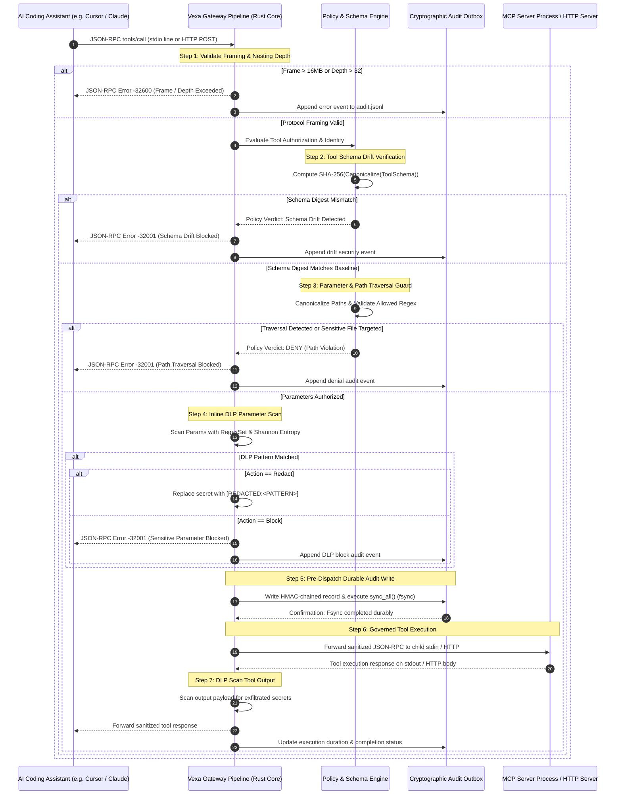
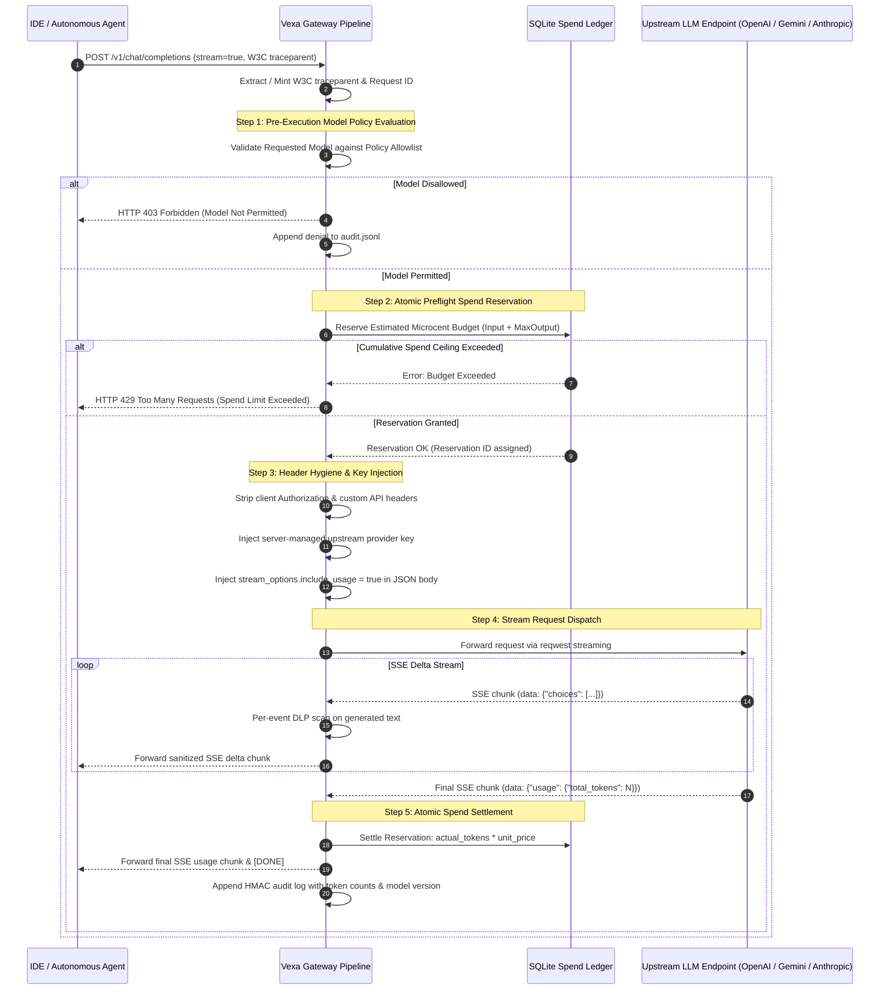
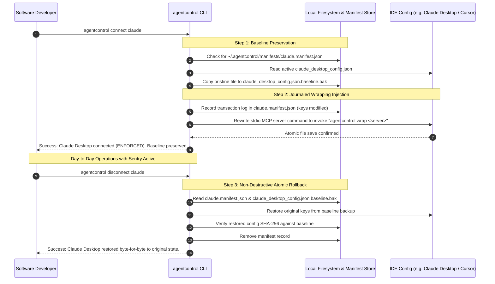
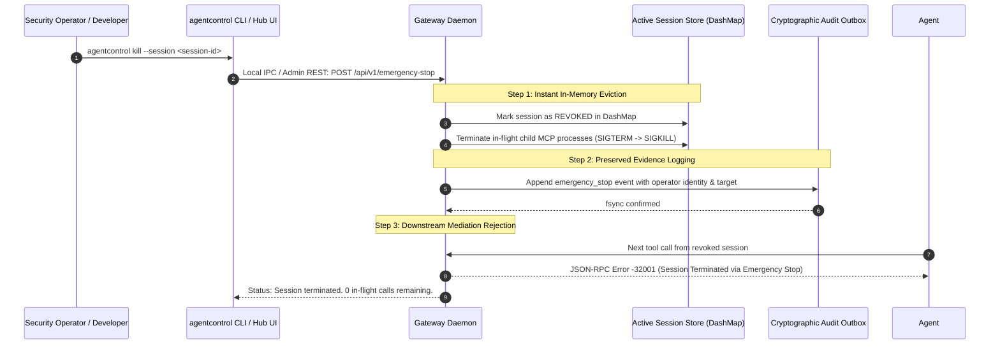

# Vexa Agent Control — Data Flows & Sequence Specifications

**Project:** Vexa Agent Control  
**Document Version:** 2.0 (PRD P0 Baseline Specification)  
**Last Updated:** 2026-10-15  
**Document Status:** Approved Engineering Specification  
**Conforms to:** [vexa-agent-control-requirements.md](file:///c:/agentcontrol/agentcontrol/PRD/pending/vexa-agent-control-requirements.md) (24 P0 FRs, 14 P0 NFRs)  

---

## 1. MCP Interception Flow: stdio & Streamable HTTP

Enforces pre-execution tool authorization (**FR-002**), protocol framing bounds (**FR-006**), schema-drift verification (**FR-007**), parameter/path validation (**FR-008**), and synchronous tamper-evident audit logging (**FR-014**, **NFR-007**).



### Detailed Execution Steps:
| Step | Subsystem | Action | Failure & Error Handling (FR-004) |
|---|---|---|---|
| **1** | Transport Layer | Read frame from stdio or loopback HTTP (`127.0.0.1:18080`). Validate size $\le 16\text{MB}$ and JSON depth $\le 32$. | Terminate with JSON-RPC error `-32600`; zero memory buffering of oversized payloads. |
| **2** | Schema Drift Engine | Compute SHA-256 digest of runtime tool schema. Compare against pinned digest in `CompiledPolicy`. | Drift triggers configured action (`block`, `warn`, or `review`). Default: `block` with error code `ERR_TOOL_SCHEMA_DRIFT`. |
| **3** | Parameter Guard | Canonicalize file paths (resolving `..`, `.`, symlinks). Assert against declared project root and sensitive path blocklists (`.ssh`, `.aws`, `.env`). | Block immediately with reason code `ERR_PATH_TRAVERSAL`. Mock tool receives zero calls. |
| **4** | Inline DLP Scanner | Scan parameter values against 20+ secret patterns and entropy threshold ($H \ge 4.5$). | In `block` mode, aborts with error `-32001`. In `redact` mode, replaces match with token while preserving JSON framing. |
| **5** | Audit Outbox | Construct `AuditEntry`, compute HMAC-SHA256 chained hash, append to `audit.jsonl`, call `sync_all()`. | If disk is full or fsync fails, high-impact tool dispatch is aborted (**FR-015**). |
| **6** | Forwarder | Write JSON-RPC payload to MCP server process stdin or HTTP endpoint. | Handle process crash or 60s timeout; return `-32000` to agent without leaking gateway stack trace. |
| **7** | Response Filter | Scan tool execution stdout/result for sensitive data or credentials. | Redact before returning to IDE; update trace duration in local SQLite `traces.db`. |

---

## 2. Universal LLM API Streaming Proxy Flow

Enforces bounded autonomy (**FR-034**), atomic spend reservation, virtual key injection (**FR-011**), W3C `traceparent` propagation (**FR-013**), and incremental SSE token settlement.



---

## 3. Human-in-the-Loop (HITL) Exact-Action Approval Flow

Enforces exact-action authorization (**FR-009**), single-use nonces, and the atomic 6-state CAS machine to eliminate race conditions and approval replays.

```mermaid
sequenceDiagram
    autonumber
    participant Agent as Agent Execution Run
    participant GW as Gateway Pipeline
    participant HITL as Local HITL Engine (CAS State Machine)
    participant UI as Developer Web Dashboard / CLI
    participant Tool as Destination Tool / MCP Server

    Agent->>GW: Invoke High-Impact Tool (e.g. bash execute: "rm -rf build/")
    GW->>GW: Evaluate Policy -> Verdict: REQUIRE_APPROVAL
    
    Note over GW,HITL: Step 1: Immutable Action Hash Computation
    GW->>GW: Compute ActionHash = SHA-256(SessionID || Tool || CanonicalParams || PolicyVer)
    GW->>HITL: Create Approval Ticket (Status: PENDING, ActionHash, Expiry: 300s)
    HITL-->>GW: Ticket ID created; hold agent connection in pending state

    Note over HITL,UI: Step 2: Presentation & Operator Review
    HITL->>UI: Broadcast Approval Request via SSE / Local IPC
    UI-->>UI: Display Tool, Redacted Arguments, ActionHash, and Expiry
    
    alt Operator Denies or Ticket Expires (300s)
        UI->>HITL: Action: REJECT / TIMEOUT
        HITL->>HITL: Atomic CAS: PENDING -> REJECTED
        HITL-->>GW: Approval Rejected
        GW-->>Agent: JSON-RPC Error -32001 (Human Approval Denied)
        GW->>GW: Log rejection in audit.jsonl
    else Operator Approves Exact Action
        UI->>HITL: Action: APPROVE (Ticket ID, Expected ActionHash)
        Note over HITL: Step 3: Atomic CAS State Transition
        HITL->>HITL: CAS: Transition PENDING -> RESERVED -> EXECUTING
        alt ActionHash Mismatch or Ticket Already Consumed
            HITL-->>UI: Error: Approval Invalidated / Already Claimed
        else CAS Transition Successful
            HITL-->>GW: Authorization Token Issued (Single-Use)
            
            Note over GW,Tool: Step 4: Dispatch Tool Execution
            GW->>Tool: Execute action with verified canonical arguments
            Tool-->>GW: Execution result received
            
            alt Process Crash / Transport Failure
                GW->>HITL: Transition EXECUTING -> OUTCOME_UNKNOWN
                GW->>GW: Log OUTCOME_UNKNOWN to audit.jsonl (No Auto-Replay)
            else Success
                GW->>HITL: Transition EXECUTING -> EXECUTED
                GW-->>Agent: Return Tool Result
                GW->>GW: Log EXECUTED audit record with approver identity
            end
        end
    end
```

---

## 4. Observe / Shadow Mode vs. Live Audit-Only Flow

Enforces observe-mode policy testing (**FR-005**) and explicit posture state reporting without confusing observation with enforcement (**FR-001**).

```mermaid
sequenceDiagram
    autonumber
    participant Agent as Developer Assistant
    participant GW as Gateway Engine
    participant Policy as Active Policy (Mode: OBSERVE)
    participant Audit as Audit Logger
    participant Tool as Target Tool

    Agent->>GW: Tool Call: execute_sql ("DROP TABLE users;")
    GW->>Policy: Evaluate Tool Action
    
    Note over Policy: Policy Engine calculates: Would DENY under Enforce
    Policy-->>GW: Verdict: WARN/OBSERVE (would_deny: true, reason: "DROP statement prohibited")
    
    Note over GW,Audit: Step 1: Record Would-Deny in Audit Log
    GW->>Audit: Append event (action: "OBSERVED_ALLOW", would_deny: true, rule: "sql_drop_guard")
    
    Note over GW,Tool: Step 2: Permit Traffic in Observe Mode
    GW->>Tool: Dispatch query (Traffic allowed to flow for tuning)
    Tool-->>GW: SQL query output
    GW-->>Agent: Forward query result
    
    Note over GW: Posture Reporting: Integration remains OBSERVED, never ENFORCED
```

---

## 5. Policy Lifecycle & Hot Reload via Self-Hosted Hub SSE

Enforces transactional policy updates, strict schema linting, and zero-downtime hot reload (**FR-017**, **FR-040**).

```mermaid
sequenceDiagram
    autonumber
    participant Admin as Security Administrator
    participant HubUI as Control Hub Web UI
    participant HubAPI as Control Hub API (Go)
    participant DB as PostgreSQL
    participant GW as Gateway Fleet (Rust)

    Admin->>HubUI: Submit New Policy YAML (v2)
    HubUI->>HubAPI: POST /api/v1/policies
    
    Note over HubAPI: Step 1: Schema Linting & Strict Validation
    HubAPI->>HubAPI: Validate YAML syntax, deny unknown fields, compile regex
    alt Invalid YAML or Bad Regex
        HubAPI-->>HubUI: HTTP 422 Unprocessable Entity (Syntax Diagnostics)
    else Validation Successful
        Note over HubAPI,DB: Step 2: Transactional Commit & Notification
        HubAPI->>DB: BEGIN Transaction
        HubAPI->>DB: Deactivate previous version; INSERT new row (is_active = true)
        HubAPI->>DB: Execute pg_notify('policy_updates', '{"id": "...", "version": 43}')
        HubAPI->>DB: COMMIT Transaction
        HubAPI-->>HubUI: HTTP 201 Created (Policy v43 Active)
        
        Note over DB,HubAPI: Step 3: SSE Delta Broadcast
        DB-->>HubAPI: NOTIFY delivered to pgx LISTEN pool
        HubAPI-->>GW: SSE Event: policy_update (id: uuid, version: 43)
        
        Note over GW: Step 4: Transactional Fetch & Atomic Swap
        GW->>HubAPI: GET /api/v1/policies/:id
        HubAPI-->>GW: HTTP 200 OK (Full YAML Body)
        GW->>GW: Deserialize YAML with noyalib & compile RegexSet
        GW->>GW: arc_swap::ArcSwap::store(new_compiled_policy)
        Note over GW: In-flight requests finish on v42; new requests use v43
        GW->>HubAPI: POST /api/v1/gateways/ack (Report policy_version = 43)
    end
```

---

## 6. Local Sentry Lifecycle: Connect, Journal, and Reversible Rollback

Enforces local-first non-destructive client configuration and byte-for-byte rollback (**FR-019**, **NFR-010**).



---

## 7. Emergency Stop & Revocation Containment Flow

Enforces immediate incident containment across local and fleet environments (**FR-016**).



---

## 8. Audit Durability, Verification, and SIEM Export Backpressure

Enforces local tamper evidence (**NFR-007**), bounded backpressure (**FR-015**), and offline verification (**FR-014**).

```mermaid
sequenceDiagram
    autonumber
    participant GW as Gateway Request Handler
    participant Writer as Background Audit Thread (sync_all)
    participant Outbox as Durable Outbox Worker
    participant SIEM as Customer SIEM (Splunk / Datadog)
    participant CLI as agentcontrol verify-log

    GW->>Writer: EntryRequest (session, tool, params_hash, decision)
    Note over Writer: Calculate HMAC(K_audit, canonical_json || prev_hmac)
    Writer->>Writer: Write JSON line to audit.jsonl
    Writer->>Writer: Issue OS fsync (sync_all)
    Writer-->>GW: Fsync confirmed -> Tool call released downstream

    Writer->>Outbox: Enqueue event for remote export
    Note over Outbox,SIEM: Decoupled Asynchronous SIEM Fan-Out
    Outbox->>SIEM: POST /services/collector (Splunk HEC batch)
    alt SIEM Timeout or Network Unavailable
        SIEM-->>Outbox: Timeout / Connection Refused
        Note over Outbox: Retry with exponential backoff; local log is safe
        Outbox->>Outbox: Record delivery lag metric; never block gateway
    else SIEM Export OK
        SIEM-->>Outbox: HTTP 200 OK
        Outbox->>Outbox: Advance remote export checkpoint
    end

    Note over CLI: --- Offline Integrity Verification ---
    CLI->>CLI: Read audit.key and audit.jsonl from disk
    loop Each line in audit.jsonl
        CLI->>CLI: Recalculate HMAC using previous line's hash
        CLI->>CLI: Assert computed HMAC == entry.hmac
    end
    CLI-->>Operator: OK: 14,250 entries verified. Chain unbroken.
```
