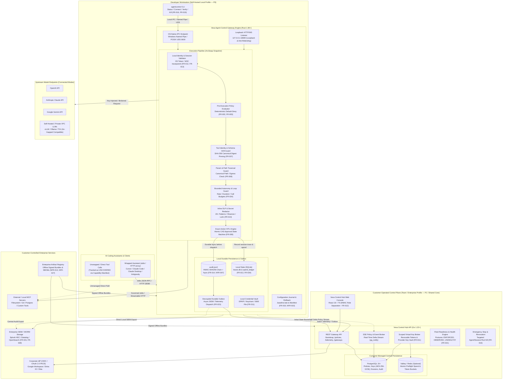

# Vexa Agent Control — System Architecture Specification

**Project:** Vexa Agent Control  
**Document Version:** 2.0 (PRD P0 Baseline Specification)  
**Last Updated:** 2026-10-15  
**Document Status:** Approved Engineering Architecture Baseline  
**Target Profiles:** Local Workstation Sentry (P0 Core) & Self-Hosted Team Hub (P1 / P0 Shared Core)  
**Requirement Baseline:** [vexa-agent-control-requirements.md](file:///c:/agentcontrol/agentcontrol/PRD/pending/vexa-agent-control-requirements.md) (24 P0 FRs + 14 P0 NFRs)  

---

## 1. Executive Summary & Architectural Ambition

### 1.1 North Star & Sovereign Self-Hosted Constraint
Vexa Agent Control is an ultra-fast, zero-trust AI security gateway and transparent runtime governance proxy engineered to govern autonomous tool-using coding agents, Model Context Protocol (MCP) servers, and LLM completions. 

The architecture enforces a strict foundational invariant (**NFR-026**):
> **Sovereign Self-Hosted Invariant:** Vexa is self-hosted software, never a Vexa-operated SaaS. All customer prompts, completions, tool parameters, policy definitions, cryptographic audit records, DLP detectors, and control-plane operations remain strictly within customer-controlled infrastructure by default. No external telemetry, heartbeat call, license check, or Vexa cloud dependency exists for normal operations.

### 1.2 Target-Market Sequence & Deployment Profiles
To prevent feature bloat while delivering enterprise-grade assurance, Vexa adheres to a disciplined delivery sequence:
1. **P0 Core / Beachhead Profile — Developer Workstation Sentry:** Low-friction, 100% offline-capable local binary and daemon for individual developers and small engineering teams governing coding assistants ([Cursor](https://cursor.com), [Claude Desktop](https://claude.ai), [Claude Code](https://github.com/anthropics/claude-code), [Google Antigravity](https://deepmind.google), [OpenAI Codex CLI](https://github.com/openai/codex), [VS Code](https://code.visualstudio.com)) and MCP tool workflows.
2. **P1 Enterprise Expansion Profile — Self-Hosted Team Hub & Proxy:** Customer-operated Docker Compose and Kubernetes Helm deployments providing shared policy distribution, scoped virtual credentials, aggregated telemetry, role-based administration, and optional air-gapped lifecycle operations.
3. **P2 Advanced Differentiation Profile:** Optional containment integrations (OS/container sandboxes, egress proxies) and GRC evidence mappings.

All deployment profiles share **one portable, deterministic policy evaluation core** (**FR-040**), ensuring that security semantics, precedence rules, and schema contracts remain identical across workstation, container sidecar, and enterprise cluster deployments.

---

## 2. System Architecture & Component Topology



---

## 3. Core Component Architecture

### 3.1 Vexa Agent Control Gateway Engine (Rust 1.80+)
The gateway engine serves as the high-throughput, low-latency data plane. Written in pure Rust without garbage collection pauses, it achieves sub-millisecond policy evaluation overhead (**NFR-014**).

#### Key Gateway Subsystems:
1. **Network & IPC Transports:**
   - **Loopback HTTP Listener (`127.0.0.1:18080`):** Built with raw `hyper 1.x` and `tokio 1.x` (ADR-001) for fine-grained control over request streaming, header hygiene, and connection lifecycle. Enforces loopback binding and anti-DNS-rebinding Host header assertions (**NFR-002**).
   - **OS-Native IPC Transport:** Windows Named Pipes with User SID DACL; POSIX Unix Domain Sockets (`~/.agentcontrol/agentcontrol.sock`) with strict `0600` permissions for CLI administration (**NFR-008**).
   - **stdio MCP Interceptor:** Child process wrapper (`tokio::process::Command`) establishing standard input/output redirection for Model Context Protocol JSON-RPC traffic.
2. **Lock-Free Policy State Cache:** Uses `arc_swap::ArcSwap<CompiledPolicy>` (ADR-002) to guarantee wait-free reads during request evaluation while allowing atomic, zero-downtime hot reloads triggered locally or via the Control Hub SSE stream.
3. **Execution Pipeline (Deterministic 10-Stage Evaluation):**
   ```
   [1. Ingress] ──► [2. Trace Binding] ──► [3. Policy Load] ──► [4. Tool AuthZ] ──► [5. Schema Drift]
          │
          ▼
   [6. Parameter Guard] ──► [7. Bounded Autonomy] ──► [8. DLP Scan] ──► [9. HITL CAS] ──► [10. Audit fsync]
   ```

---

### 3.2 Policy Engine & Decision Contract (FR-002, FR-003, FR-004, FR-040)
The policy engine is the authoritative, deterministic decision maker. It implements a strict pre-execution authorization gate: every mediated action must be evaluated and authorized *before* dispatch to downstream tools or upstream models (**FR-002**).

#### Versioned Decision State Machine (Decision Contract v2):
```
               ┌───────────────────────────────┐
               │    Evaluator Input Event      │
               └───────────────┬───────────────┘
                               │
                Match against active policy
                               │
       ┌───────────────────────┼────────────────────────┐
       ▼                       ▼                        ▼
┌──────────────┐      ┌──────────────────┐     ┌──────────────────┐
│    ALLOW     │      │ REQUIRE_APPROVAL │     │       DENY       │
└──────┬───────┘      └────────┬─────────┘     └────────┬─────────┘
       │                       │                        │
       ▼                       ▼                        ▼
Execute Action         Dispatch HITL CAS        Block Downstream
(Durable Audit)        (Block until decision)   (Emit Reason Code)
       │                       │                        │
       └───────────────────────┼────────────────────────┘
                               ▼
               ┌───────────────────────────────┐
               │     ERROR / INDETERMINATE     │
               │ (Fails Closed in Enforce Mode)│
               └───────────────────────────────┘
```

#### Decision Obligations & Result Mapping:
| Decision Value | Precedence | Action on Tool / LLM Request | Audit Obligation | Safe Mode Fallback |
|---|---|---|---|---|
| `ALLOW` | Lowest | Permitted downstream dispatch | Durable HMAC audit logged | Only if explicitly matched |
| `WARN / OBSERVE` | Intermediate | Permitted downstream dispatch | Durable audit with `is_warn: true` | Record would-deny in observe mode |
| `REQUIRE_APPROVAL` | High | Intercepted; held until HITL resolution | Audit state transition to `PENDING` | Revert to `DENY` on timeout |
| `DENY` | High | Terminated immediately; zero downstream calls | Durable audit with denial reason code | Default response for absent rule |
| `ERROR / INDETERMINATE` | Authoritative | Blocked immediately (Fail-Closed) | Audit evaluator/syntax fault | High-impact actions blocked (**FR-004**) |

#### Safe-Failure Decision Matrix (FR-004):
When anomalous system conditions occur, the gateway deterministically executes configured safe-failure behaviors:
- **Missing or Invalid Policy:** Fails closed (`DENY`) for all tools under default profile.
- **DLP / Classifier Timeout:** Aborts execution and returns `ERROR/INDETERMINATE`; no silent bypass.
- **Audit Persistence Failure (Disk Full / fsync Error):** Blocks consequential/write tool actions immediately (**FR-015**).
- **Control Plane Disconnection:** Continues local policy enforcement from cached state for up to configurable TTL (default 1 hour); never fails open.

---

### 3.3 Zero-Trust MCP Tool Firewall & Schema Drift Engine (FR-006, FR-007)
The Model Context Protocol (MCP) firewall mediates tool calls, resources, and prompt definitions across stdio and Streamable HTTP transports.

#### Protocol Framing & Quota Enforcements (FR-006):
- **Maximum Frame Size:** Enforces strict 16 MiB boundary (`MAX_FRAME_SIZE = 16 * 1024 * 1024`); payloads exceeding boundary are rejected with JSON-RPC `-32600` without buffering into memory.
- **Maximum JSON Nesting Depth:** Recursive descent parser terminates at 32 levels (`MAX_JSON_DEPTH = 32`) to prevent stack overflow or algorithmic complexity attacks.
- **Tool Execution Timeout:** Default 60-second execution deadline enforced via Tokio timeout combinators.
- **Process Memory RSS Ceiling:** MCP child process memory capped at 64 MiB RSS via platform cgroups (Linux) or Job Objects (Windows).

#### Tool Pinning & Schema Drift Detection (FR-007):
To prevent malicious MCP server updates or tool-name collisions from hijacking approved permissions:
1. **Canonical Schema Hashing:** On initial discovery/connection, the gateway canonicalizes the tool's JSON schema (sorted keys, stripped whitespace) and computes a SHA-256 digest:
   $$\text{Digest} = \text{SHA-256}(\text{Canonicalize}(\text{ToolSchema}))$$
2. **Runtime Verification:** Before evaluating a tool execution request, the gateway validates that the active tool's schema digest matches the pinned digest in the policy.
3. **Drift Enforcement:** Any modification (added/removed arguments, altered types, modified description) triggers configured behavior:
   - `block`: Fails request with reason code `ERR_TOOL_SCHEMA_DRIFT`.
   - `warn`: Allows action while emitting high-priority security audit alert.
   - `review`: Suspends action into HITL approval queue.

---

### 3.4 Parameter, Path & Egress Guard (FR-008)
Tool authorization must not rely solely on tool names. The parameter guard enforces deep syntactic and semantic constraints:
- **Path Traversal Blocker:** Canonicalizes filesystem paths using OS-native resolution (resolving `..`, `.`, symlinks, and alternate path separators). Prohibits path escapes outside declared project roots.
- **Sensitive Directory Guard:** Blocks access to `.ssh/`, `.aws/`, `.gnupg/`, `.env`, `/etc/shadow`, and SAM registries regardless of relative paths.
- **Network Egress Constraints:** Validates target URLs against allowed schemes (`http`, `https`), enforces destination domain allowlists, and blocks SSRF targets (RFC 1918 private IPs, AWS/GCP metadata endpoints `169.254.169.254`).
- **Parameter Type Enforcement:** Validates arguments against typed schemas (regex matching, enum boundaries, integer limits, string length).

---

### 3.5 Inline DLP & Secret Hygiene (FR-010, NFR-006)
Prevents credential exfiltration and sensitive data disclosure across prompts, completions, tool parameters, and tool execution outputs:
- **Multi-Algorithm Scanner Engine:**
  - **Single-Pass RegexSet:** Evaluates 20+ pre-compiled pattern families (AWS keys, GitHub PATs, private keys, connection strings, Slack tokens).
  - **Shannon Entropy Analysis:** Computes string entropy ($H \ge 4.5$) on high-randomness character blocks to catch unformatted secrets.
  - **Luhn Algorithm Validator:** Validates Visa, MasterCard, and Amex credit card numbers to eliminate false positives.
  - **BIP-39 Mnemonic Checker:** Detects 12- and 24-word cryptocurrency seed phrases.
- **Redaction vs. Blocking Modes:**
  - `redact`: Replaces sensitive matches with structured tokens (`[REDACTED:<PATTERN_NAME>]`) while preserving valid JSON syntax.
  - `block`: Immediately aborts processing and returns HTTP 403 / JSON-RPC `-32001` with zero secret exposure in error text.
- **Privacy Minimization (NFR-006):** Canary secrets are validated in CI to ensure that raw credentials never leak into audit logs, error messages, metrics, or crash dumps.

---

### 3.6 Exact-Action Human-in-the-Loop (HITL) Engine (FR-009)
For high-impact or consequential operations (file writes, shell execution, database drops, external money transfers), Vexa halts execution pending explicit human authorization.

#### Cryptographic Action Binding:
Approvals are bound to an immutable SHA-256 hash of the normalized request payload:
$$\text{ActionHash} = \text{SHA-256}(\text{SessionID} \parallel \text{ToolName} \parallel \text{CanonicalParams} \parallel \text{PolicyVersion})$$

#### Atomic 6-State CAS Machine:
```
           ┌──────────┐
           │ PENDING  │
           └────┬─────┘
                │ Atomically claim (acquire mutex / CAS)
                ▼
           ┌──────────┐
           │ RESERVED │
           └────┬─────┘
                │ User approves
                ▼
           ┌───────────┐      Crash / Failure     ┌─────────────────┐
           │ EXECUTING ├─────────────────────────►│ OUTCOME_UNKNOWN │
           └────┬──────┘                          └─────────────────┘
                │ Action completes successfully
                ▼
           ┌───────────┐
           │ EXECUTED  │
           └───────────┘
```
- **Single-Use Authorization:** Consumed approval tokens are immediately invalidated. Replay attempts fail.
- **Anti-Mutation Guarantee:** Any variance in tool arguments between request and approval invalidates the token.
- **Crash Recovery:** A crash during dispatch moves state to `OUTCOME_UNKNOWN`; actions are never automatically replayed without human confirmation.

---

### 3.7 Run Correlation, Trace Context & Bounded Autonomy (FR-013, FR-034)
- **W3C Distributed Tracing (FR-013):** Every mediated request generates or propagates a W3C `traceparent` header (`version-trace_id-parent_id-flags`) and `X-Request-ID`. Correlates parent agent sessions to nested child tool executions.
- **Bounded Autonomy Limits (FR-034):**
  - **Run Duration Caps:** Maximum active execution time per agent session (e.g., max 30 minutes).
  - **Tool-Call Count & Rate Ceilings:** Enforces sliding-window rate limits (calls/sec) and maximum cumulative tool executions per run (e.g., max 50 tool invocations).
  - **Recursive Loop Detection:** Tracks tool-call signature history ($H = \text{SHA-256}(\text{Tool} \parallel \text{Args})$); detects $N$ identical failed calls and triggers `PivotError` or session termination.
  - **Atomic Spend Ceilings:** Microcent budget reservations ($1.00 = 100,000,000\ \mu\text{cents}$) reserved *before* upstream model dispatch.

---

### 3.8 Cryptographic Audit Outbox & Verifier (FR-014, FR-015, NFR-007)
Audit records provide verifiable proof of agent activity while maintaining metadata-first privacy.

#### HMAC-SHA256 Chained Ledger:
Every audit entry is sequentially chained to its predecessor:
$$\text{EntryHMAC} = \text{HMAC-SHA256}(K_{\text{audit}}, \text{CanonicalJSON}(\text{EntryWithoutHMAC}) \parallel \text{prev\_hmac})$$
The first log entry utilizes the zero-hash sentinel:
$$\text{prev\_hmac}_0 = \text{"0000000000000000000000000000000000000000000000000000000000000000"}$$

#### Durability & Backpressure (FR-015, NFR-007):
- **Local Synchronous Persistence:** The gateway writer issues a blocking `sync_all()` (fsync) to disk *before* dispatching tool calls downstream. High-impact operations fail closed if the local audit write fails.
- **Decoupled Durable Outbox:** Network SIEM exports (Splunk HEC, Datadog Logs, OpenSearch) and Control Hub telemetry uploads run in an asynchronous background worker pool with bounded in-memory queues and persistent retries.
- **Offline CLI Verification:** The `agentcontrol verify-log` command recalculates HMAC chains offline from local key storage, immediately reporting file tampering, omitted lines, or reordering.

---

### 3.9 Reversible Configuration & Packaging Engine (FR-019, NFR-008, NFR-010)
Workstation integration must be non-destructive and fully reversible:
- **Non-Destructive Wrapping:** When connecting coding assistants (`agentcontrol connect cursor`), the gateway journals original configuration files (`~/.agentcontrol/manifests/<client>.manifest.json`) and writes immutable backups (`<config>.baseline.bak`).
- **Atomic Rollback:** Running `agentcontrol disconnect <client>` or uninstalling restores original client settings byte-for-byte without erasing unrelated user customizations.
- **Crash Recovery:** Interrupted installation or update automatically reverts to baseline configuration during startup health checks.

---

### 3.10 Self-Hosted Control Hub & Enterprise Architecture (P1 / Shared Core)
For multi-developer and enterprise environments, the self-hosted Control Hub provides centralized policy governance without compromising the sovereign boundary:
- **Control Hub API (Go 1.22+):** Lightweight Go service managing tenant schemas, role-based access control (RBAC), and policy distributions.
- **Server-Sent Events (SSE) Delta Distribution:** Gateways maintain persistent HTTP SSE connections (`GET /api/v1/events`). When an administrator publishes a signed policy update, PostgreSQL triggers `pg_notify`, and the SSE broker fans out version delta alerts (`{policy_id, version}`). Gateways fetch full YAML transactionally and execute atomic ArcSwap reload (**FR-017**).
- **Scoped Virtual Key Custody (FR-011):** Upstream provider API keys (OpenAI, Anthropic, Gemini) are stored encrypted in customer PostgreSQL databases using AES-256-GCM. The hub issues scoped virtual tokens (`vx-live-...`) to developers, injecting upstream keys strictly inside customer-controlled broker containers.
- **Fleet Posture Monitoring (FR-001, FR-021):** Aggregates gateway health, reporting distinct protection states (`ENFORCED`, `OBSERVED`, `UNCOVERED`, `UNHEALTHY`).

---

## 4. Cross-Cutting Concerns

### 4.1 Security Architecture & Explicit Threat Boundaries (NFR-001, NFR-002)
Vexa maintains strict transparency regarding its security trust boundary:
- **Protected Vectors:** Malicious prompts/jailbreaks, rogue tool execution, unauthorized filesystem access, SSRF egress, token budget exhaustion, credential leaks, and browser CSRF/DNS rebinding.
- **Explicit Workstation Boundary Disclaimer:** Vexa runs as a user-level daemon. It does **not** claim to defend against hostile code running as the same OS user with root/administrator privileges, or against direct out-of-band network calls made by unwrapped binaries. Workstation defense must be coupled with OS-level isolation (containers/sandboxes) for high-risk untrusted code.

### 4.2 Protection Posture States (FR-001, FR-005, FR-021)
The gateway and CLI reject binary "protected / unprotected" simplifications, enforcing a 7-state posture model:
1. `CONFIGURED`: Configuration exists but connectivity is unverified.
2. `CONNECTIVITY_VERIFIED`: Transport loopback and IPC verified; no live traffic observed.
3. `TRAFFIC_OBSERVED`: Traffic actively flowing through gateway proxy.
4. `ENFORCED_TESTED`: Policy enforcement confirmed via synthetic conformance fixtures.
5. `OBSERVED_ONLY`: Running in shadow mode; decisions logged without blocking.
6. `UNCOVERED`: Identified path has no mediation (e.g., direct cloud egress in Claude Desktop or unwrapped shell executions).
7. `UNHEALTHY`: Process offline, policy stale/invalid, or audit disk full.

---

## 5. Requirements Traceability Matrix (P0 Compliance)

| Requirement ID | Requirement Summary | Architectural Component & Realization Mechanism |
|---|---|---|
| **FR-001** | Declared Coverage & Blind Spots | Section 3.1 & 4.2: Machine-readable Capability Manifest, 7-state posture model. |
| **FR-002** | Pre-Execution Tool Authorization | Section 3.2: 10-stage pipeline halts dispatch until deterministic policy evaluates allow. |
| **FR-003** | Deterministic Decision Contract | Section 3.2: Versioned contract (`ALLOW`, `DENY`, `REQUIRE_APPROVAL`, `WARN`, `ERROR`). |
| **FR-004** | Explicit Safe-Failure Modes | Section 3.2: Fail-closed safe-failure matrix for evaluator faults and disk-full errors. |
| **FR-005** | Observe / Shadow vs. Enforce | Section 3.2 & 4.2: Live audit-only mode logging would-deny decisions without blocking. |
| **FR-006** | MCP Transport & Frame Validation | Section 3.3: 16MB frame limit, 32-level depth bound, 60s timeout, 64MB RSS quota. |
| **FR-007** | Tool Pinning & Schema Drift | Section 3.3: SHA-256 canonical schema digest pinning and drift intervention. |
| **FR-008** | Parameter, Path & Egress Guard | Section 3.4: OS-native path canonicalization, traversal checks, SSRF IP blockers. |
| **FR-009** | Exact-Action HITL Approvals | Section 3.6: ActionHash binding, 6-state CAS machine (`PENDING` to `EXECUTED`). |
| **FR-010** | Secret & DLP Redaction | Section 3.5: RegexSet, Shannon entropy, Luhn validator, structured redaction tokens. |
| **FR-011** | Credential Boundary & Key Custody | Section 3.1 & 3.10: OS-native storage (DPAPI/Keychain/0600) and central AES-256-GCM vault. |
| **FR-012** | Identity Attribution & Roles | Section 3.1 & 3.10: OIDC JWT validation, role separation (Admin, Approver, Auditor). |
| **FR-013** | Run Correlation & Trace Context | Section 3.7: W3C `traceparent` propagation and unique analytical session graph. |
| **FR-014** | Verifiable Audit Records | Section 3.8: Append-only HMAC-SHA256 chained `audit.jsonl` with metadata-first default. |
| **FR-015** | Audit Failure & Backpressure | Section 3.8: Synchronous local `sync_all()`, decoupled async outbox with queue bounds. |
| **FR-016** | Emergency Stop & Revocation | Section 2 & 3.10: Scoped kill-switch for agents, sessions, tools, and credentials. |
| **FR-017** | Policy Lifecycle & Rollback | Section 3.2 & 3.10: Versioned YAML schema, fixture tests, atomic ArcSwap rollback. |
| **FR-018** | Security Test Runner & Conformance | Section 3.1 & 4.2: Machine-readable conformance test runner blocking CI releases. |
| **FR-019** | Local-First & Reversible Wrapping | Section 3.9: 100% offline local execution, `.baseline.bak` non-destructive rollback. |
| **FR-021** | Health, Readiness & Posture | Section 4.2: Component readiness probes separating liveness from enforcement posture. |
| **FR-023** | Retention & Payload Access Controls | Section 3.5 & 3.8: Metadata-only default, segregated raw payload access logging. |
| **FR-024** | Open Interface & Portable Export | Section 1.1 & 3.10: Open versioned JSON/YAML schemas, sovereign export without SaaS. |
| **FR-034** | Bounded Autonomy Budgets | Section 3.7: Sliding-window rate limits, duration caps, microcent spend reservations. |
| **FR-040** | Shared Core Across Deployments | Section 1.2: Shared Rust core engine across Local CLI, Docker, and Kubernetes. |
| **NFR-001** | Threat Model Accuracy | Section 4.1: Transparent documentation of same-user and OS security boundaries. |
| **NFR-002** | Secure Defaults & Least Privilege | Section 3.1 & 4.1: Loopback-only binding (`127.0.0.1`), OS-specific IPC ACLs. |
| **NFR-003** | Safe Degradation & Visibility | Section 4.2: Distinct health reporting; unmediated paths labeled `UNCOVERED`. |
| **NFR-004** | Bounded Resource Consumption | Section 3.3: Strict memory, nesting depth, and execution duration bounds. |
| **NFR-006** | Privacy Minimization & Secrets | Section 3.5: Zero canary secrets in logs; opt-in raw payload capture. |
| **NFR-007** | Audit Integrity & Durability | Section 3.8: Cryptographic HMAC chain with documented trust boundary limits. |
| **NFR-008** | Cross-Platform Parity | Section 3.1 & 3.9: Windows (Named Pipes/DPAPI), macOS (UDS/Keychain), Linux (`0600`). |
| **NFR-009** | Conformance Gates | Section 3.1 & Traceability: Automated CI conformance blocking regressions on release. |
| **NFR-010** | Reversible Install & Upgrade | Section 3.9: Journaled config mutations with idempotent restoration. |
| **NFR-011** | Actionable Explanations | Section 3.2: Human-readable denial reasons with rule names and remediation advice. |
| **NFR-012** | Versioned Interoperable Schemas | Section 3.2, 3.8, 3.10: Versioned contract APIs with strict backward compatibility. |
| **NFR-013** | Verified Release & Vulnerability | Section 1.1: Traceable release artifacts, published SBOMs, and security disclosure. |
| **NFR-014** | Measured Performance | Section 3.1: Stage-level latency benchmarks (p50/p95/p99) on pinned reference targets. |
| **NFR-026** | Sovereign Self-Hosted Invariant | Section 1.1: 100% offline capability, zero external telemetry or SaaS dependency. |

---

## 6. Architectural Decision Records (ADRs) Summary

| ADR Reference | Architectural Decision | Chosen Implementation | Core Benefit & Justification |
|---|---|---|---|
| **ADR-001** | HTTP Server Layer | Raw `hyper 1.x` & `tokio` | Direct socket & frame control without middleware bloat; low latency. |
| **ADR-002** | Policy Hot Reload | `arc_swap::ArcSwap<PolicyState>` | Lock-free, wait-free reads during request evaluation; atomic swap. |
| **ADR-003** | DLP Scanning Engine | Single-pass `RegexSet` + Luhn | Fast scanning over streaming text frames; minimal memory overhead. |
| **ADR-004** | Policy Deserializer | `noyalib` (forbid unsafe) | Memory-safe YAML parsing replacing deprecated serde_yaml. |
| **ADR-005** | Identity & JWT Validation | `openidconnect` crate | Strict spec-compliant OIDC JWT claims validation and cached JWKS. |
| **ADR-006** | Policy Delta Distribution | SSE via PostgreSQL `pg_notify` | ID-only notifications avoiding payload size limits; robust scaling. |
| **ADR-007** | HMAC Key Custody | Local Key File with OS ACL | Self-contained cryptographic verification without remote service. |
| **ADR-008** | MCP Transport Support | stdio & Streamable HTTP | Full compatibility with both desktop CLI agents and remote servers. |
| **ADR-009** | Audit Ledger Architecture | HMAC `audit.jsonl` + SQLite traces | Decouples cryptographic integrity from rich forensic graph indexing. |
| **ADR-010** | HITL State Machine | 6-State Atomic CAS | Eliminates approval race conditions, replay attacks, and crash loops. |
