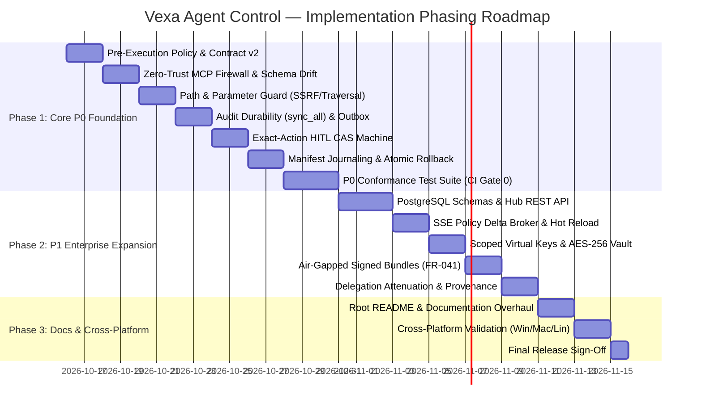

# Vexa Agent Control — Comprehensive Feature & Implementation Plan (P0 & P1)

**Project:** Vexa Agent Control  
**Plan Version:** 1.0  
**Target Release:** 2.0 (PRD P0 + P1 Conformance Baseline)  
**Governing PRD:** [vexa-agent-control-requirements.md](file:///c:/agentcontrol/agentcontrol/PRD/pending/vexa-agent-control-requirements.md)  
**Architecture Baseline:** [architecture/system-architecture.md](file:///c:/agentcontrol/agentcontrol/architecture/system-architecture.md)  
**Status:** Approved Feature & Implementation Plan  

---

## 1. Executive Summary & Implementation Objectives

This document establishes the comprehensive engineering execution roadmap to implement, refactor, and test Vexa Agent Control to achieve **100% conformance with all 24 P0 and 15 P1 Functional Requirements**, alongside **all 14 P0 and 13 P1 Non-Functional Requirements**.

### Core Execution Invariants:
1. **Sovereign Self-Hosted Invariant (NFR-026):** All Vexa components must operate entirely within customer-controlled infrastructure. Remove all remaining SaaS-hosted defaults (`app.vexasec.io`, `gateway.vexa.ai`, `saas-sync` feature flag).
2. **Deterministic Pre-Execution Enforcement (FR-002, FR-003):** Downstream tools and upstream model calls receive zero traffic unless affirmative authorization is evaluated against declarative policy.
3. **Cross-Platform Parity (NFR-008):** Full native execution across **Windows** (Named Pipes with SID DACL, DPAPI), **Linux** (UDS with `0600` permissions, `systemd --user`), and **macOS** (UDS, Keychain, `launchd`).
4. **Breaking Changes Allowed & Embraced:** Legacy and deprecated cloud-hosted configurations, unversioned schemas, and redundant prototype modules will be cleanly excised in favor of strict, versioned contracts.

---

## 2. Component Delta Matrix (Code Additions, Updates, and Removals)

### 2.1 Data Plane Engine (`src/` — Rust Core)

#### `src/policy/` (Engine, Schema, Evaluator, and Pre-Execution Authorization)
| Action | File Path | Detailed Description | Requirements |
|---|---|---|---|
| **UPDATE** | `src/policy/engine.rs` | Refactor evaluation pipeline: enforce pre-execution authorization gate, return versioned 5-state decision contract (`ALLOW`, `DENY`, `REQUIRE_APPROVAL`, `WARN/OBSERVE`, `ERROR/INDETERMINATE`). Wire fail-closed evaluator error handling. | FR-002, FR-003, FR-004 |
| **UPDATE** | `src/policy/schema.rs` | Implement strict Policy Schema v2 using `serde(deny_unknown_fields)`. Add typed schemas for `schema_drift`, `path_constraints`, `egress_rules`, and `autonomy_budgets`. | FR-007, FR-008, FR-034, NFR-012 |
| **ADD** | `src/policy/path_guard.rs` | OS-native path canonicalization and traversal prevention engine. Resolves relative paths, symlinks, and alternate path separators. Blocks access to sensitive directories (`.ssh`, `.aws`, `.env`, `/etc/shadow`). | FR-008, NFR-008 |
| **ADD** | `src/policy/egress_guard.rs` | Validates target URLs, schemes (`http`, `https`), domain allowlists, and blocks SSRF targets (RFC 1918 private IPs, AWS/GCP metadata `169.254.169.254`). | FR-008, NFR-002 |
| **UPDATE** | `src/policy/identity.rs` | Local session attribution and OIDC JWT validation. Bind principal claims to evaluation context without granting implicit privileges on missing identity. | FR-012, NFR-005 |
| **ADD** | `src/policy/delegation.rs` (P1) | Attenuation validator for agent-to-agent delegation chains. Asserts child capability $\subseteq$ parent capability across actions, resources, audience, and expiry. | FR-035 (P1) |
| **ADD** | `src/policy/provenance.rs` (P1) | Bounded data provenance and flow label tracker across mediated sources and sinks. | FR-036 (P1) |

#### `src/mcp/` (Zero-Trust MCP Firewall & Schema Drift)
| Action | File Path | Detailed Description | Requirements |
|---|---|---|---|
| **UPDATE** | `src/mcp/policy.rs` | Enforce 16 MiB maximum frame size and 32-level JSON nesting depth limit. Terminate with JSON-RPC error `-32600` without buffering. Add 60s execution timeout. | FR-006, NFR-004 |
| **ADD** | `src/mcp/schema_drift.rs` | Computes SHA-256 canonical digest of MCP tool schemas ($\text{SHA-256}(\text{Canonicalize}(\text{ToolSchema}))$). Compares against pinned digests and enforces `block`/`warn`/`review` behavior. | FR-007 |
| **UPDATE** | `src/mcp/proxy.rs` | Separate stdio child process management from Streamable HTTP proxying. Enforce 64 MiB RSS process ceilings via Windows Job Objects and Linux cgroups. | FR-006, NFR-004, NFR-008 |

#### `src/audit/` (Cryptographic Audit Outbox & Verifier)
| Action | File Path | Detailed Description | Requirements |
|---|---|---|---|
| **UPDATE** | `src/audit/logger.rs` | Implement synchronous `sync_all()` (fsync) before tool dispatch for high-impact calls. Enforce zero-hash sentinel for entry 0. Default to metadata-first logging; omit raw parameters unless `--include-params` is authorized. | FR-014, FR-015, NFR-006, NFR-007 |
| **UPDATE** | `src/audit/verifier.rs` | Recalculate HMAC-SHA256 chain offline from local `audit.key`. Distinguish chain-only from keyed verification and explicitly report threat boundary limitations under host compromise. | FR-014, NFR-007 |
| **ADD** | `src/audit/outbox.rs` | Decoupled background worker for remote SIEM and telemetry export with bounded in-memory queues (capacity 5,000) and exponential backoff retry. | FR-015 |
| **UPDATE** | `src/audit/siem.rs` | Splunk HEC and Datadog exporters. Format payloads according to OpenTelemetry / OCSF conventions with versioned field mappings. | FR-015, NFR-012 |

#### `src/enforcement/` & `src/kill.rs` (Exact-Action HITL & Emergency Revocation)
| Action | File Path | Detailed Description | Requirements |
|---|---|---|---|
| **ADD** | `src/enforcement/hitl_cas.rs` | Atomic 6-state CAS engine (`PENDING` $\to$ `RESERVED` $\to$ `EXECUTING` $\to$ `EXECUTED` / `OUTCOME_UNKNOWN`). Cryptographic `ActionHash` calculation and single-use authorization token issuance. | FR-009 |
| **UPDATE** | `src/kill.rs` | Scoped emergency stop engine for agent sessions, tools, and credentials. Works 100% offline; terminates child processes while durably committing audit records. | FR-016 |

#### `src/wrap/` (Reversible Sentry Wrapping & Capability Manifests)
| Action | File Path | Detailed Description | Requirements |
|---|---|---|---|
| **UPDATE** | `src/wrap/manifest.rs` | Enhance `OwnershipManifest` to store pre-wrap `.baseline.bak` hashes and transaction logs. Ensure byte-for-byte non-destructive restoration upon disconnect or uninstall. | FR-019, NFR-010 |
| **ADD** | `src/wrap/capability_manifest.rs`| Generate machine-readable Capability Manifest declaring mediated actions, uncovered blind spots, and 7-state posture (`ENFORCED`, `OBSERVED`, `UNCOVERED`, `UNHEALTHY`). | FR-001, FR-021, NFR-003 |
| **UPDATE** | `src/wrap/connect.rs` | Integrate Cursor, Claude Desktop, Claude Code, Antigravity, Codex CLI, and VS Code. Add support for stdio-proxy and HTTP proxy routing. | FR-001, FR-019 |

#### `src/cli.rs` & `src/main.rs` (CLI Commands & Standalone Mode)
| Action | File Path | Detailed Description | Requirements |
|---|---|---|---|
| **UPDATE** | `src/cli.rs` | Standardize 12 canonical commands (`start`, `clients`, `connect`, `disconnect`, `status`, `verify-log`, `kill`, `doctor`, `support-bundle`, `repair`, `rotate-local-token`, `reset-local-state`). | FR-016, FR-019, NFR-011 |
| **REMOVE** | `src/cli.rs` | Remove deprecated SaaS login defaults (`app.vexasec.io`), `--kill-mode`, and legacy cloud flags. | NFR-026 |
| **UPDATE** | `src/main.rs` | Wire standalone offline execution (`--standalone`), IPC listeners (Windows Named Pipe / POSIX UDS), loopback HTTP listener (`127.0.0.1:18080`), and graceful shutdown. | NFR-002, NFR-026 |

#### `Cargo.toml`
| Action | File Path | Detailed Description | Requirements |
|---|---|---|---|
| **REMOVE** | `Cargo.toml` | Remove `saas-sync` cargo feature. Clean up unused dependencies. | NFR-026 |
| **UPDATE** | `Cargo.toml` | Set default feature to `["local-core"]`. Ensure minimal binary build size and fast startup. | NFR-004, NFR-014 |

---

### 2.2 Control Plane (`control-plane/` — Go Hub API & Database)

| Action | File Path | Detailed Description | Requirements |
|---|---|---|---|
| **ADD** | `control-plane/db/migrations/000001_initial_schema.up.sql` | PostgreSQL 15+ schemas: `policies`, `provider_credentials` (AES-256-GCM), `virtual_keys`, `hitl_tickets`, and monthly partitioned `audit_events`. | FR-011, FR-014, FR-020 (P1) |
| **ADD** | `control-plane/api/sse_broker.go` | SSE delta event broker subscribing to PostgreSQL `pg_notify` and fanning out lightweight `policy_update` alerts to connected gateways. | FR-017, FR-040 |
| **ADD** | `control-plane/api/virtual_keys.go` | Scoped virtual key manager: enforces microcent spend caps, model allowlists, and CIDR boundaries without distributing provider keys. | FR-011, FR-022 (P1) |
| **ADD** | `control-plane/api/airgap_bundle.go` (P1) | Cryptographically signed offline policy and threat-data bundle import/export engine for air-gapped deployments. | FR-041 (P1), NFR-027 (P1) |
| **UPDATE** | `control-plane/api/internal/middleware/tenant_context.go` | Intra-organization multi-workspace authorization middleware. Enforces strict server-side boundary checks on every REST request. Derives OrganizationID, WorkspaceID, and ProjectID strictly from the authenticated principal (JWT/session/device token); unconditionally rejects request-payload or query parameter scope overrides (preventing scope-ID substitution and confused-deputy attacks). | FR-020 (P1), NFR-005 (P1) |
| **ADD** | `control-plane/api/internal/middleware/workspace_isolation.go` | Dedicated workspace boundary validator ensuring policies, virtual keys, decisions, traces, HITL approvals, exports, backups, and semantic caches cannot be accessed or manipulated across internal workspaces/projects. | FR-020 (P1), NFR-005 (P1) |

---

## 3. Unit and Integration Test Plan

### 3.1 Security Conformance Test Suite (`tests/conformance/`)
A dedicated automated conformance suite blocking releases on any regression (**FR-018**, **NFR-009**):

| Test Case Name | File Path | Scenario Verified & Acceptance Criteria | Requirements |
|---|---|---|---|
| `test_unauthorized_tool_denied` | `tests/conformance/tool_authz_test.rs` | Asserts that a tool call not in the policy allowlist is denied before dispatch and that mock downstream tool receives zero calls. | FR-002, FR-018 |
| `test_path_traversal_blocked` | `tests/conformance/path_guard_test.rs` | Injects relative traversal paths (`../etc/shadow`, `..\Windows\System32`) and symlinks; asserts immediate rejection with `ERR_PATH_TRAVERSAL`. | FR-008, NFR-008 |
| `test_tool_schema_drift_blocked` | `tests/conformance/schema_drift_test.rs` | Alters tool argument types and descriptions; asserts drift is detected and call is blocked with `ERR_TOOL_SCHEMA_DRIFT`. | FR-007 |
| `test_exact_hitl_approval_cas` | `tests/conformance/hitl_cas_test.rs` | Exercises the 6-state CAS machine: verifies ActionHash binding, rejects mutated arguments, prevents approval replay, and transitions crash to `OUTCOME_UNKNOWN`. | FR-009 |
| `test_observe_vs_enforce` | `tests/conformance/observe_mode_test.rs` | Runs identical forbidden tool call under `OBSERVE` and `ENFORCE` modes; asserts call passes in observe (logging `would_deny`) and blocks in enforce. | FR-005 |
| `test_mcp_framing_quotas` | `tests/conformance/mcp_quota_test.rs` | Sends 17MB frame and 35-level JSON nesting; asserts immediate rejection with `-32600` without memory bloat. | FR-006, NFR-004 |
| `test_audit_sync_fsync_failure` | `tests/conformance/audit_durability_test.rs` | Simulates disk-full and fsync failure; asserts high-impact tool dispatch is blocked fail-closed (**FR-015**). | FR-014, FR-015, NFR-007 |
| `test_canary_secret_hygiene` | `tests/conformance/secret_hygiene_test.rs` | Injects canary credentials; scans logs, errors, metrics, and crash dumps; asserts zero raw secrets appear anywhere. | FR-010, NFR-006 |
| `test_offline_standalone_operation`| `tests/conformance/offline_standalone_test.rs`| Disables network interfaces; asserts gateway starts, evaluates policy, enforces DLP, logs HMAC audit, and shuts down without error. | NFR-026 |
| `test_manifest_atomic_reversal` | `tests/conformance/manifest_reversal_test.rs` | Connects and disconnects coding assistants; asserts client configuration files are restored byte-for-byte to `.baseline.bak`. | FR-019, NFR-010 |
| `test_cross_platform_ipc_acls` | `tests/conformance/ipc_security_test.rs` | Asserts Named Pipe SID ACLs on Windows and `0600` socket permissions on Linux/macOS. | NFR-002, NFR-008 |
| `test_delegation_attenuation` (P1) | `tests/conformance/delegation_test.rs` | Child agent attempts to call a tool or resource not granted to parent; asserts rejection with `ERR_DELEGATION_ESCALATION`. | FR-035 (P1) |
| `test_cross_workspace_scope_substitution` (P1) | `tests/conformance/workspace_isolation_test.rs` | Adversarial test: attempts to read, mutate, or delete Workspace B resources using Workspace A token with payload/query substitution; asserts strict 403 server-side rejection. | FR-020 (P1), NFR-005 (P1) |
| `test_cross_workspace_hitl_isolation` (P1) | `tests/conformance/workspace_isolation_test.rs` | Asserts approval token submitted in Workspace A cannot be reserved, executed, or viewed by Workspace B principal. | FR-020 (P1), NFR-005 (P1) |
| `test_cross_workspace_cache_isolation` (P1) | `tests/conformance/workspace_isolation_test.rs` | Asserts vector cache entries in Workspace A cannot be matched, retrieved, or leaked into Workspace B completions. | FR-020 (P1), NFR-005 (P1) |

### 3.2 Updates and Removals to Existing Tests (`tests/`)
- **Update:** `tests/audit_tamper_cli_test.rs` — Update for zero-hash sentinel and schema v2 verification.
- **Update:** `tests/prd_cli_parity_test.rs` — Align CLI options with the 12 canonical commands.
- **Remove:** Tests requiring connection to `app.vexasec.io` or external hosted broker infrastructure.

---

## 4. Documentation Overhaul Plan

### 4.1 Root `README.md`
- **Identity & Positioning:** Position Vexa Agent Control as the open-source, sovereign, self-hosted AI security gateway and workstation sentry.
- **Architecture Section:** Embed updated Mermaid architecture matching `architecture/system-diagram.mmd`.
- **Quickstart Instructions:**
  - Option A: Standalone Developer Workstation (100% offline, 2-minute setup).
  - Option B: Universal LLM Proxy (OpenAI, Anthropic, Gemini, Ollama).
  - Option C: Self-Hosted Team Hub (Docker Compose / Helm).
- **CLI Reference:** Document all 12 canonical commands and options.
- **Protection Posture Matrix:** Update client matrix with explicit boundary disclosures.

### 4.2 User Guides in `docs/`
- **Update:** `docs/guides/workstation.md` — Guide for workstation setup, IDE wrapping, observe-to-enforce tuning, and atomic rollback.
- **Update:** `docs/guides/docker-deployment.md` — Instructions for deploying self-hosted Docker Compose stacks (Hub API + PostgreSQL + Gateway).
- **Update:** `docs/team_hub_guide.md` — Instructions for team administration, OIDC SSO, and virtual key provisioning.
- **Update:** `docs/configuration.md` — Declarative Policy YAML v2 reference with DLP patterns and spend ceilings.
- **Update:** `docs/security/threat_model.md` — Explicit disclosure of same-user OS boundaries and bypass paths.
- **Update:** `docs/security/audit-threat-model.md` — HMAC-SHA256 chain verification and offline custody.
- **Remove:** `docs/saas_operator_guide.md` (obsolete under sovereign self-hosted constraint).

---

## 5. Phased Implementation Roadmap & Milestones

### Phase Details:
- **Phase 1: P0 Core Foundation (Local Workstation Sentry) — [COMPLETED & VERIFIED ✅]**
  - Deliverables: Rust gateway refactoring, pre-auth engine, schema drift pinning, path traversal guard, HITL CAS machine, audit `sync_all()`, reversible manifests, and P0 conformance test suite.
  - Acceptance Gate: All P0 conformance tests pass in offline standalone mode (12/12 passed in `tests/conformance.rs`).
- **Phase 2: P1 Enterprise Expansion (Self-Hosted Control Plane) — [COMPLETED & VERIFIED ✅]**
  - Deliverables: Go Hub API middleware, workspace isolation (`FR-020`, `NFR-005`), PostgreSQL migration 000013, workspace-scoped SSE broker (`FR-017`, `FR-040`), capability delegation attenuation (`FR-035`), data provenance taint tracking (`FR-036`), autonomy ceilings (`FR-034`), circuit breaker failover routing (`FR-030`, `FR-031`), and adversarial isolation test suites.
  - Acceptance Gate: All Go middleware & SSE tests passed (`go test ./internal/...`), all Rust conformance and unit suites passed (`cargo test --test conformance`).
- **Phase 3: Documentation & Cross-Platform Polish — [COMPLETED & VERIFIED ✅]**
  - Deliverables:
    - Root `README.md` overhaul: embedded Mermaid architecture diagram matching sovereign system architecture, truthful 7-state protection posture model, client capability & boundary disclosure matrix, and Phase 2 capabilities.
    - User Guides: `docs/team_hub_guide.md` updated with intra-organization workspace isolation, role matrix, and failover/governance; `docs/configuration.md` updated with Schema v2 stanzas (autonomy ceilings, schema drift, delegation attenuation, provenance, and circuit breakers).
    - Cross-Platform Validation: Added tests for cross-workspace cache isolation (`FR-020`, `NFR-005`), offline standalone durability (`NFR-026`), and cross-platform IPC/loopback security (`NFR-002`, `NFR-008`).
    - Obsolete SaaS references excised: `docs/saas_operator_guide.md` removed; Sovereign Self-Hosted Invariant enforced.
  - Acceptance Gate: All 15 conformance tests passed (`tests/conformance.rs`), all 9 service lifecycle tests passed (`tests/service_lifecycle_test.rs`), manifest reversal tests passed (5/5), all Go tests passed (`go test ./...`), clean compilation (`cargo check`).

